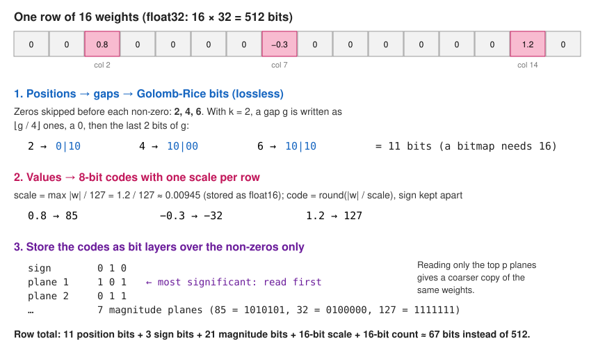
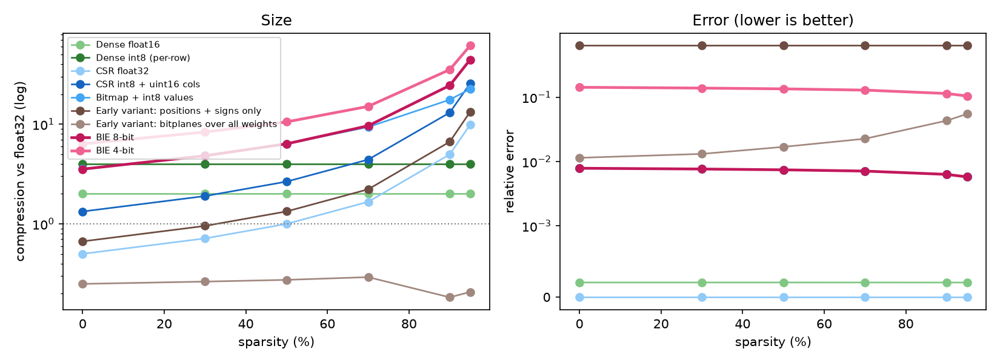
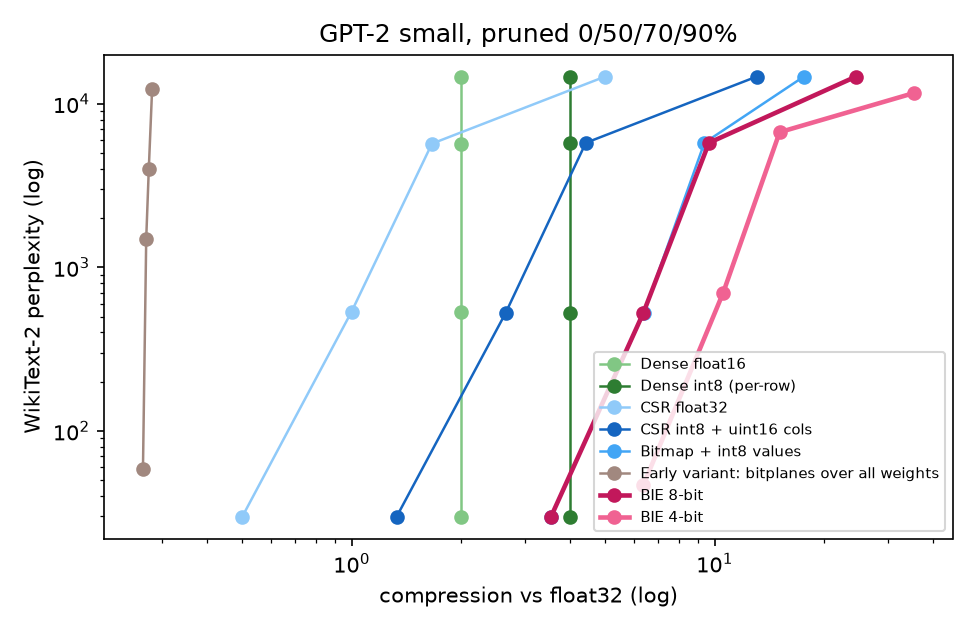

# BIE: Bit-Index Encoding for Sparse Neural Network Weights

A storage format for weight matrices that are mostly zeros. Instead of keeping every weight, BIE keeps **where the non-zeros are**, coded bit by bit, plus a short integer code for **what each non-zero is**. On a matrix that is 95% zeros it stores the weights **44.5× smaller than float32 with 0.6% error**, and its multiply kernel works directly on that form.

This repository holds the encoder and decoder, a multiply kernel, a benchmark against standard formats (dense float16 and int8, CSR, bitmap), a test on the real weights of GPT-2, and the run files behind every number below.

## Why sparse weights need their own format

Pruning sets most of a network's weights to zero. A dense array still spends 32 bits on every zero, so the model gets no smaller. The usual sparse formats help, but they carry a cost:

- **CSR** stores, for each non-zero, its value (32 bits) and its column number (usually 32 bits). At 50% sparsity that is exactly as large as the dense matrix.
- **Bitmap** stores one bit per weight to say "zero or not", then the non-zero values. The bitmap costs the same at 95% zeros as at 5%.

Both spend more on *positions* than they need to. At 95% sparsity the non-zeros are about 20 columns apart on average, and that gap fits in a handful of bits, not 32. BIE is built around coding those gaps tightly.

## How BIE stores a matrix



Each row is stored in three parts. The figure follows one row of 16 weights with non-zeros 0.8, −0.3 and 1.2 in columns 2, 7 and 14.

### 1. Positions: gaps, Golomb-Rice coded

For each non-zero, BIE counts how many zeros came before it since the previous non-zero in the row: here **2, 4, 6**. Small gaps are common and large gaps rare, the shape a **Golomb-Rice code** is designed for. With parameter k, a gap g is written as:

- ⌊g / 2ᵏ⌋ one-bits, then a zero (the "how many blocks of 2ᵏ" part);
- the last k bits of g (the remainder).

With k = 2: 2 → `0 10`, 4 → `10 00`, 6 → `10 10`, which is 11 bits for the whole row. A bitmap would need 16 bits and CSR 96. The encoder tries every k from 0 to 16 and keeps the one that gives the fewest bits for the matrix. If a plain bitmap would be smaller (at low sparsity), it stores the bitmap instead. Positions are always **lossless**.

### 2. Values: signed 8-bit codes, one scale per row

Every non-zero keeps its value, rounded to an integer code:

- scale = (largest |weight| in the row) / 127, stored once per row as float16;
- code = round(|weight| / scale), between 0 and 127, with the sign kept separately.

In the example the scale is 1.2 / 127 ≈ 0.00945, so 0.8 → 85, −0.3 → −32 and 1.2 → 127. Decoding multiplies back: 85 × 0.00945 = 0.803, a 0.4% error. **Zeros are never quantised, so they stay exactly zero.** A 4-bit setting (codes 0–7) gives a smaller file with more error.

### 3. Codes stored as bit layers (bitplanes)

The 7-bit magnitudes are not stored code by code but layer by layer. One plane holds the most significant bit of every non-zero's code, the next plane the next bit, and so on, plus one plane of signs. A reader that loads only the **top p planes** gets every weight at lower precision, using the middle of the remaining interval. One file can therefore serve a quick, coarse version and the full version.

**Total for the example row:** 11 position bits + 3 sign bits + 21 magnitude bits + a 16-bit scale + a 16-bit non-zero count ≈ 67 bits, against 512 bits as float32.

### Multiplying

To compute Y = W·X, the positions are decoded once when the matrix is loaded into row starts and column numbers. The values stay as int8 codes with their row scales. The kernel ([`src/bie/codec.py`](src/bie/codec.py), compiled with Numba) gives each CPU thread whole output rows: it walks that row's non-zeros and adds code × scale × (matching row of X). No two threads ever write to the same output row, so no locks are needed and the result is exact up to float rounding.

The compact bit-level form is for storage and transfer. While multiplying, positions are held as 32-bit column numbers.

## Results

All numbers come from `experiments/runs/*.json`, measured on a cloud machine (AMD EPYC 75F3, 16 vCPU, RTX 4090). Matrix experiments and timings ran on the CPU, GPT-2 perplexity on the GPU. The full tables are in [experiments/RESULTS.md](experiments/RESULTS.md).

**What is compared:**

| Format | What it stores |
|---|---|
| Dense float16 / int8 | every weight at 16 or 8 bits (int8 with one scale per row) |
| CSR float32 | value (32 bits) + column (32 bits) per non-zero, plus row starts |
| CSR int8 | int8 value + 16-bit column per non-zero, plus row starts and scales |
| Bitmap + int8 | 1 bit per weight + int8 value per non-zero |
| **BIE 8-bit / 4-bit** | Rice-coded positions + sign and magnitude planes, as above |
| Early BIE variants | two first designs, kept to show why the final design keeps values and zeros: *positions + signs only* (every non-zero becomes ±1) and *bitplanes over all weights* (8-bit codes over each matrix's [min, max]) |

**Two measurements:**

- **Size** (ratio = float32 bytes ÷ bytes actually stored), counted from the arrays a format really keeps, not from a formula.
- **Error** = ‖W − Ŵ‖ / ‖W‖, how far the decoded matrix is from the original (0 = exact).

### 1. Size and error on sparse matrices

Gaussian random weights with a random set of positions zeroed, at sparsity 0–95%. Matrices are 256×256 to 2048×1024, with 3 seeds each. The figure and table show 1024×1024; other sizes give the same picture, and seed-to-seed spread is at most 0.2 in ratio.



| Format | Size at 50% zeros | at 90% | at 95% | Error |
|---|---|---|---|---|
| Dense int8 (per-row) | 3.99× | 3.99× | 3.99× | 0.006–0.007 |
| CSR float32 | 1.00× | 4.98× | 9.91× | 0 |
| CSR int8 + uint16 columns | 2.65× | 13.09× | 25.68× | 0.006–0.007 |
| Bitmap + int8 values | 6.38× | 17.63× | 22.61× | 0.006–0.007 |
| **BIE 8-bit** | 6.36× | **24.52×** | **44.50×** | 0.006–0.007 |
| BIE 4-bit | 10.55× | 35.34× | 61.63× | 0.105–0.135 |
| Early variant: positions + signs only | 1.33× | 6.67× | 13.34× | 0.636 |
| Early variant: bitplanes over all weights | 0.27× | 0.18× | 0.21× | 0.017–0.055 |

**How to read it:**

- **Same error, smaller file.** BIE 8-bit, CSR int8 and bitmap + int8 quantise the non-zeros in the same way, so their errors are identical; the only difference is how positions are stored. At 95% zeros, Rice-coded gaps cost about 6 bits per non-zero, against 16 for CSR's column numbers and 20 per non-zero for a bitmap (1 bit × 20 weights). That is why BIE is 1.7× smaller than CSR int8 and 2× smaller than the bitmap.
- **The gain grows with sparsity.** At 50% zeros the best Rice code spends about one bit per weight, the same as a bitmap, so BIE ties with bitmap + int8. Below about 50%, plain dense int8 is smaller than any sparse format, BIE included.
- **Why the early variants were dropped:**
  - Storing only positions and signs throws away every magnitude, so every weight comes back as ±1 (64% error).
  - Quantising over [min, max] maps zero to a non-zero code, so the zeros are not exploited and the file is 3–5× larger than float32.

### 2. Multiply speed

W·X with W 2048×1024 and X 64 columns; median of 7 runs, in milliseconds.

| Zeros | Dense float32 (BLAS) | SciPy CSR float32 | **BIE kernel** | BIE position decode, once at load |
|---|---|---|---|---|
| 50% | **0.43** | 8.13 | 0.68 | 12.67 |
| 70% | **0.36** | 5.03 | 0.49 | 7.23 |
| 90% | 0.27 | 1.72 | **0.16** | 2.47 |
| 95% | 0.24 | 0.85 | **0.11** | 1.38 |
| 99% | 0.28 | 0.25 | **0.10** | 0.38 |

- The BIE kernel is 2.5–12× faster than SciPy's CSR multiply at every sparsity tested (10–12× at 50–90% zeros).
- Against an optimised dense multiply (BLAS), BIE wins from 90% zeros upward and loses at 50–70%. With so few zeros skipped, a dense multiply's regular memory access beats following an index.
- The kernel's output matches multiplying its own decoded matrix to within 8.6 × 10⁻⁷ of the output scale.

### 3. Reading fewer bit layers

One 8-bit BIE file of a 1024×1024 matrix, decoded from only its top p magnitude planes (mean of 3 seeds):

| Planes read | Bits per value (incl. sign) | Error at 50% zeros | Error at 90% zeros |
|---|---|---|---|
| 1 | 2 | 0.478 | 0.410 |
| 2 | 3 | 0.239 | 0.205 |
| 3 | 4 | 0.120 | 0.103 |
| 4 | 5 | 0.061 | 0.052 |
| 5 | 6 | 0.032 | 0.028 |
| 6 | 7 | 0.020 | 0.017 |
| 7 | 8 | 0.007 | 0.006 |

Each extra plane roughly halves the error, as expected when each bit halves the rounding step.

### 4. Real weights: GPT-2 small

The test takes all 84.9 million weights in GPT-2 small's 48 attention and MLP matrices. Each matrix is pruned by setting its smallest-magnitude weights to zero, at 0%, 50%, 70% and 90%, with no retraining. The pruned weights are then stored in each format, decoded and loaded back into the model. Quality is perplexity on the WikiText-2 test set (287,644 tokens; lower is better).



| Format | 0% pruned: size / perplexity | 50% | 70% | 90% |
|---|---|---|---|---|
| Dense float32 (reference) | 1.00× / 29.9 | 1.00× / 534.8 | 1.00× / 5,700 | 1.00× / 14,615 |
| Dense int8 (per-row) | 3.99× / 30.0 | 3.99× / 526.5 | 3.99× / 5,765 | 3.99× / 14,671 |
| Bitmap + int8 values | 3.55× / 30.0 | 6.38× / 526.5 | 9.37× / 5,765 | 17.62× / 14,671 |
| **BIE 8-bit** | 3.54× / 30.0 | 6.36× / 526.5 | 9.64× / 5,765 | **24.54×** / 14,671 |
| BIE 4-bit | 6.36× / 46.5 | 10.56× / 701.5 | 15.11× / 6,700 | 35.41× / 11,623 |
| Early variant: positions + signs only | 0.67× / >10⁵ | 1.33× / >10⁵ | 2.21× / >10⁵ | 6.63× / >10⁵ |
| Early variant: bitplanes over all weights | 0.27× / 58.9 | 0.27× / 1,490 | 0.28× / 3,987 | 0.28× / 12,281 |

**How to read it:** compare each row with the float32 row in the same column. A storage format should not change perplexity beyond what pruning already did.

- **BIE 8-bit keeps quality.** Its perplexity is 30.0 against 29.9, the same as dense int8. On real weights it reaches the same size gains as on random matrices, 24.5× at 90% pruning.
- **BIE 4-bit costs quality on a dense model** (perplexity 46.5): 8 levels per weight are too coarse for GPT-2.
- **The high perplexities at 50–90% come from the pruning, not from the formats.** GPT-2 small does not survive having half its weights removed without retraining. BIE's large savings only pay off on a model trained to be sparse, which this test does not include.

## Limits

- Below about 50% zeros, dense int8 is smaller and faster; BIE is for strongly sparse matrices.
- The compact bit form has to be decoded once before multiplying; during computation positions take 32 bits each.
- The kernel is CPU only. Speed was measured on one matrix shape.
- The size advantage on a real network was shown on pruned GPT-2 weights, but no sparse-trained model was tested, so there is no end-to-end result where a model is both much smaller and still accurate.
- The parts are established techniques: index-gap coding with entropy codes (as in Deep Compression, Han et al., 2015), Golomb-Rice codes and per-channel int8 quantisation. What this project contributes is putting them together into a working, measured format with a bitplane layout and a row-parallel kernel.

## Reproduce

```bash
pip install -r requirements.txt
bash experiments/run_all.sh
```

`run_all.sh` runs three scripts:

1. `run_synthetic.py`: size, error, speed and bit layers on random matrices.
2. `run_gpt2.py`: downloads GPT-2 and WikiText-2 from Hugging Face; uses a GPU if one is present.
3. `make_report.py`: writes `experiments/RESULTS.md` and the charts in `docs/figures/`.

The full run takes about 4 minutes on the machine above.

Using the format directly:

```python
import numpy as np
from src.bie import codec

W = np.random.randn(1024, 1024).astype(np.float32)
W[np.random.rand(*W.shape) < 0.95] = 0           # 95% zeros

E = codec.encode(W, bits=8)                      # compress
print(W.nbytes / E.nbytes())                     # ≈ 44× smaller
W_hat = codec.decode(E)                          # full precision
W_coarse = codec.decode(E, planes=3)             # top 3 bit layers only

op = codec.BIEOperator(E)                        # decode positions once
Y = op.matmul(np.random.randn(1024, 64).astype(np.float32))
```

## Repository layout

```
src/bie/codec.py            BIE: encode, decode, progressive decode, multiply kernel
src/bie/early_encoder.py    the two early variants (positions-only, bitplanes over all weights; also 64x64 tiles)
src/bie/early_kernels.py    multiply kernels for the early variants
experiments/methods.py      every format behind one interface; sizes counted from stored arrays
experiments/run_synthetic.py, run_gpt2.py, make_report.py, run_all.sh
experiments/runs/           raw results (JSON)
experiments/RESULTS.md      full tables
docs/figures/               format diagram and result charts
```

## License

MIT.
